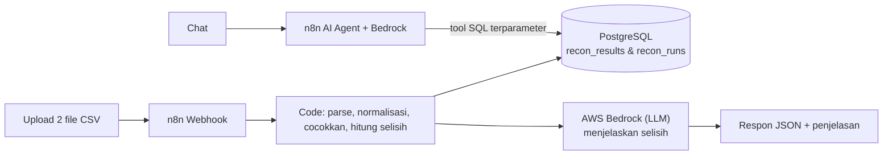

# Tax Recon AI

Rekonsiliasi dokumen pajak (cek selisih angka antara dua sumber) + chatbot AI, dibangun dengan **n8n**, **AWS Bedrock**, dan **PostgreSQL**.

> **Prinsip utama:** angka dihitung oleh **kode** (deterministik), bukan oleh LLM. AI hanya dipakai untuk menjelaskan penyebab selisih dan menjawab pertanyaan di chat, dan untuk angka selalu memanggil query database.

## Arsitektur



## Isi repo

| Path | Fungsi |
|---|---|
| `src/core.js` | Logika rekonsiliasi (tanpa dependency). Dipakai CLI, tes, dan di-embed ke n8n |
| `config/mapping.json` | Mapping nama kolom file Anda, toleransi, locale angka |
| `n8n/workflow-1-rekonsiliasi.json` | Workflow: upload, hitung, simpan, penjelasan AI |
| `n8n/workflow-2-chatbot.json` | Workflow: chatbot AI Agent dengan tool query database |
| `scripts/build-n8n.js` | Membuat JSON workflow dari `src/core.js`, config, dan prompt |
| `scripts/run-local.js` | Menjalankan rekonsiliasi dari terminal tanpa n8n/AWS |
| `web/chat.html` | Antarmuka web chat (1 file HTML) untuk chatbot, dengan login |
| `prompts/` | Prompt LLM (penjelasan selisih & chatbot) |
| `db/init.sql` | Skema database |
| `docker-compose.yml`, `caddy/` | n8n + Postgres (+ HTTPS opsional) |
| `aws/iam-policy-bedrock.json` | Kebijakan IAM minimal untuk Bedrock |
| `sample-data/` | Data contoh yang mencakup semua status |
| `docs/` | `DESIGN.md` (desain sistem + diagram), `N8N-CONFIG.md` (konfigurasi n8n), `PROCESS.md`, `DEPLOY-AWS.md`, `EVIDENCE*.md` (bukti uji) |
| `tests/` | Unit test, tes workflow n8n, dan `tests/e2e/` (UI chat di browser + logika SQL) |

## Mulai cepat

### 1. Coba tanpa n8n/AWS (hanya Node.js 18+)

```bash
npm test                 # unit test
npm run recon            # jalankan pada sample-data/, hasil di output/
npm run recon -- --a data/a.csv --b data/b.csv --tolerance 10
```

### 2. Jalankan n8n + Postgres

```bash
cp .env.example .env     # isi password & N8N_ENCRYPTION_KEY (openssl rand -hex 24)
docker compose up -d
# buka http://localhost:5678
```

### 3. Siapkan AWS Bedrock

1. Konsol Bedrock, aktifkan akses ke model yang ingin dipakai (di region Anda).
2. Buat IAM user dengan kebijakan `aws/iam-policy-bedrock.json` lalu buat access key.
3. Di n8n: **Credentials, New, AWS**, isi access key, secret, dan region.
4. Di n8n: **Credentials, New, Postgres**, host `postgres`, database `taxrecon`, user/password dari `.env`.

### 4. Import workflow

1. n8n, **Import from File**: `n8n/workflow-1-rekonsiliasi.json` dan `n8n/workflow-2-chatbot.json`.
2. Pilih credential Postgres/AWS di node yang bertanda merah dan **pilih model** di node *Bedrock Chat Model*.
3. Aktifkan (Activate) workflow 1.

### 5. Tes

Di node *Webhook Upload*, buat credential **Header Auth** (Name `X-API-Key`, Value = kunci acak buatan Anda) lalu pasang. Kemudian:

```bash
curl -X POST http://localhost:5678/webhook/tax-recon \
  -H "X-API-Key: KUNCI_ANDA" \
  -F fileA=@sample-data/faktur_pajak.csv \
  -F fileB=@sample-data/laporan_penjualan.csv \
  -F tolerance=10
```

Respon berisi `summary`, `top_discrepancies`, dan `ai_explanation`. Setelah itu, siapkan chatbot di langkah 6.

### 6. Web chat (chatbot siap pakai)

1. Di n8n, buat credential **Basic Auth** (username + password pilihan Anda) dan pasang di node *Chat Trigger* workflow 2.
2. Pilih credential Postgres/AWS/model, lalu **Activate** workflow 2.
3. Salin **Production URL** dari node Chat Trigger (bentuknya `https://domain-anda/webhook/<id>/chat`).
4. Buka `web/chat.html` di browser (bisa langsung klik dua kali, atau `?url=<Production URL>` di alamat), isi URL + login, lalu mulai bertanya.

Untuk membagikan ke tim, host `web/chat.html` di **GitHub Pages** atau S3/CloudFront. n8n harus memakai **HTTPS** agar tidak diblokir browser. Batasi asal yang boleh mengakses saat build workflow:

```bash
CHAT_ALLOWED_ORIGINS=https://USERNAME.github.io npm run build:n8n
```

Contoh pertanyaan: *"Ringkasan rekonsiliasi terakhir"*, *"Tampilkan 5 selisih terbesar"*, *"Cek faktur yang berakhiran 0002"*, *"Dokumen mana yang hanya ada di sumber A?"*.

> Halaman chat itu sendiri tidak berisi data. Data hanya bisa diakses lewat n8n yang dilindungi login. Jangan membuka Chat Trigger tanpa autentikasi.

## Menyesuaikan dengan data Anda

Edit `config/mapping.json`: ganti nama kolom di `sourceA` dan `sourceB`, atur `tolerance` (Rp), `locale` (`id`/`en`/`auto`), dan opsional `ppnRate` (misal `0.11`) untuk menandai PPN yang tidak sesuai tarif. Setelah mengubah `config/`, `src/`, atau `prompts/`:

```bash
npm run build:n8n   # lalu import ulang workflow di n8n
```

File Excel (.xlsx): ekspor ke CSV dulu, atau tambahkan node *Extract From File* sebelum node Code.

## Status hasil

| Status | Arti |
|---|---|
| `MATCH` | Kunci sama, DPP & PPN persis sama |
| `MATCH_ROUNDING` | Selisih masih dalam toleransi |
| `AMOUNT_MISMATCH` | DPP/PPN berbeda melebihi toleransi |
| `PERIOD_MISMATCH` | Nominal cocok, tetapi bulan berbeda |
| `ONLY_IN_A` / `ONLY_IN_B` | Hanya ada di salah satu sumber |
| `DUPLICATE_KEY` | Kunci muncul lebih dari sekali (nilai dijumlahkan) |

## Keamanan

- Data pajak itu sensitif: **jangan commit data asli** (`.gitignore` sudah memblokir `data/`, `*.xlsx`, `.env`).
- Chatbot hanya memakai **query SQL tetap & terparameter**, AI tidak menulis SQL. Gunakan user Postgres read-only (lihat `db/init.sql`).
- Aktifkan HTTPS (`--profile prod`), batasi Security Group, dan pasang *AWS Budgets* agar biaya terpantau. Lihat `docs/DEPLOY-AWS.md`.
- Webhook sebaiknya diberi autentikasi (Header Auth) sebelum dibuka ke publik.

## Batasan yang perlu diketahui

- Workflow JSON dibuat dari script dan diuji strukturnya, serta kode di node Code disimulasikan. Namun versi node n8n berubah dari waktu ke waktu; jika ada node yang ditandai error saat import, sesuaikan parameternya secara manual.
- Aturan pajak (tarif, format NPWP 15/16 digit, masa pajak) bisa berubah. Verifikasi asumsi di `src/core.js` dengan peraturan terbaru.
- Penjelasan AI adalah alat bantu, **bukan nasihat pajak**.
